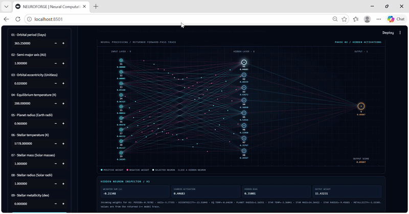
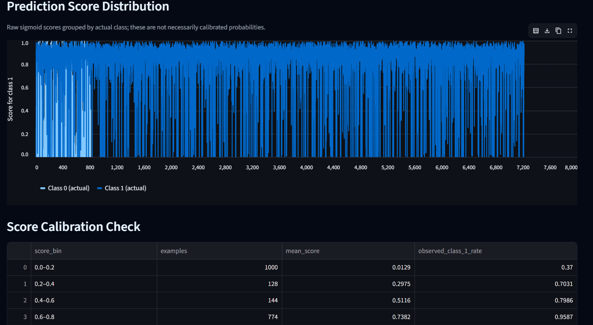
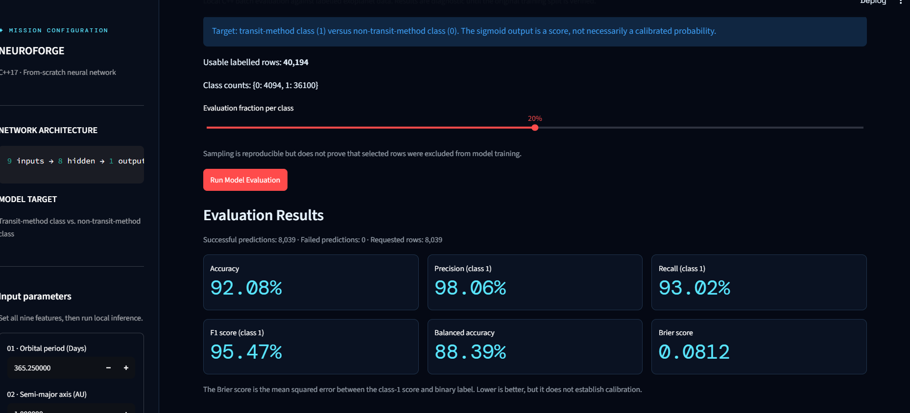
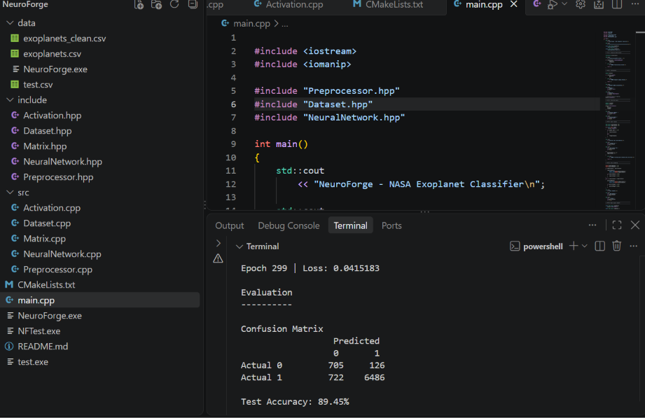

# Neuro_Forge
## 🎬 Demo



## 📸 Screenshots

### Screenshot 1


### Screenshot 2


### Screenshot 3

# NeuroForge

I built a small neural network **from scratch in C++17**, with no machine-learning libraries, and tested it on real planet data from NASA. The project also has a dashboard, so anyone can open the network up and watch it think.


## The short version

- **The question:** Can a tiny neural network look at 9 numbers about a planet and its star, and guess whether the planet was found with the **transit method** or a **different method**?
- **The transit method** means a planet passes in front of its star and the star gets a little dimmer.
- **What it does NOT do:** it does not tell you if something is a real planet. It only guesses *how the planet was found*. Please don't read its answer as a discovery.
- **The data:** 40,194 planet rows from the NASA Exoplanet Archive. 36,100 were found by transit and 4,094 by other methods.
- **The network:** 9 inputs → 8 middle neurons → 1 output. That is only 89 numbers that it learns.
- **Why I built it:** I wanted to understand what libraries like PyTorch hide. So I wrote the matrices, the guessing, and the learning myself.

## What it looks like

**Screenshot 1: how sure the model was, planet by planet**


**Screenshot 2: the dashboard's report card**


**Screenshot 3: training the network in the terminal (one of my training runs)**


## How it works (no math needed)

Think of the network as a tiny machine with 89 dials. Training is turning the dials until the machine guesses well.

1. **Clean the data.** Some planets are missing some numbers. I fill each gap with the middle value (the median) of that column. Then I squeeze every column to between 0 and 1, so that big numbers (like temperatures) don't drown out small ones (like eccentricity).
2. **Look at one planet.** The 9 numbers go into the network. Each of the 8 middle neurons mixes the numbers together and passes on a signal. The output neuron mixes those 8 signals into one **score between 0 and 1**.
3. **Make a guess.** A score of 0.5 or more means "transit method". Less than 0.5 means "some other method".
4. **Check the answer.** The network compares its score to the real answer.
5. **Nudge the dials.** It figures out which dials caused the mistake and turns each one a tiny bit (this is called *backpropagation* and *gradient descent*).
6. **Repeat.** It does this for every planet in the training set, 300 times over.

Two details:
- The network starts with random dials, and the train/test split is random too. So **every training run gives slightly different results**.
- Most planets in the data were found by transit, so the network could cheat by always saying "transit". To stop that, I made mistakes on the rarer group count about 9 times more (the code allows up to 20 times).

| Setting | Value |
|---|---|
| Layers | 9 inputs → 8 middle neurons → 1 output |
| Activation | Sigmoid (squashes any number into 0 to 1) |
| Learning rate | 0.01 |
| Training rounds (epochs) | 300 |
| Train / test split | 80% / 20%, random |
| Loss at the end of the run in Screenshot 3 | 0.0415183 |

<details>
<summary>The math, if you want it</summary>

```
middle neuron   = sigmoid( weights · inputs + bias )
output score    = sigmoid( weights · middle neurons + bias )
sigmoid(x)      = 1 / (1 + e^-x)

error           = (score - real answer) × class weight
each dial       = dial - learning rate × (how much it caused the error)
```

All of this is in `src/NeuralNetwork.cpp`.
</details>

## The 9 inputs

| Input | What it means | Unit |
|---|---|---|
| `pl_orbper` | How long the planet takes to go around its star | days |
| `pl_orbsmax` | How far the planet is from its star | AU (1 AU = Earth to Sun) |
| `pl_orbeccen` | How squished the orbit is (0 = a perfect circle) | no unit |
| `pl_eqt` | The planet's temperature (balance between heating and cooling) | K |
| `pl_rade` | The planet's size | Earth radii |
| `st_teff` | How hot the star's surface is | K |
| `st_mass` | The star's mass | Sun masses |
| `st_rad` | The star's size | Sun radii |
| `st_met` | How much of the star is "metals" (anything heavier than hydrogen and helium) | dex |

The label is **1** if NASA lists the discovery method as "Transit", and **0** for every other method.

## Results

Here is one real run of `main.cpp` (Screenshot 3). The data was split randomly: 32,155 rows to train on and 8,039 rows held back to test on. (Limitation 4 explains why even a held-back test can look a bit better than it should.)

```
                 Predicted
                 0       1
Actual 0       705     126
Actual 1       722    6486
```

| Measure | Result | In plain words |
|---|---|---|
| Accuracy | 89.45% | About 89 guesses out of 100 were right |
| Balanced accuracy | 87.41% | The average of how well it did on each group (see below) |
| Precision | 0.98 | When it said "transit", it was right 98 times out of 100 |
| Recall | 0.90 | Of the real transit planets, it found 90 out of 100 |

**Be careful with accuracy here.** About 9 in 10 planets in the data are transit planets. A "model" that just says "transit" every single time would get about 90% accuracy and learn nothing. In Screenshot 3's test set, 7,208 of 8,039 planets (89.7%) are transit, which is *slightly higher* than the network's 89.45% accuracy. That is why I also report **balanced accuracy**. It gives each group an equal vote, so a lazy "always transit" guess scores only 50%. Balanced accuracy of 87.41% shows the network really did learn something about the rarer group too. But it still missed 722 transit planets and wrongly called 126 non-transit planets "transit", so it is not a strong model.

**The dashboard shows different numbers (92.08% accuracy).** The two don't match because they are different tests: a different run of the network, and different planets. See "Limitations" for why the dashboard number is not a fair test.

## The dashboard

This is the Streamlit app (`app.py`). It runs the C++ network through a small helper program (`neuroforge_bridge.exe`) on your own computer. It doesn't use any outside AI service.

**How to use it:** type 9 numbers into the left side panel and press **PROCESS THROUGH NETWORK**. The boxes start with Earth-and-Sun-like values. With those, the network gives a score of **0.0981**, so it says **Non-Transit-method class**. (A score under 0.5 means "not transit".)

The page has these parts, from top to bottom:

### Left side panel
- The 9 input boxes with their units, and the big button.
- A small box that says what the network is (9 → 8 → 1) and what it is guessing (transit method vs. other method).
- "Bridge: AVAILABLE" means the helper program was found. If it says NOT FOUND, the dashboard can't run the network.

### 4 small cards (after you press the button)
Architecture (9 → 8 → 1), Activation (Sigmoid), the **Output Score**, and the **Predicted Class**.

### 01 Neural Microscope: a picture of the network
- **Left column of circles = the 9 inputs** (labelled I1 to I9). The number under each is that input after being squeezed into 0 to 1.
- **Middle column = the 8 middle neurons** (H1 to H8). The number under each is how strongly that neuron "lit up" (0 to 1).
- **Right circle = the output** (Y), with the final score.
- **The lines are the dials (weights).** Blue lines are positive weights and pink lines are negative weights. Thicker lines are bigger weights.
- The little dots moving along the lines show the signal going from left to right.
- **Click any middle neuron (H1 to H8).** A panel under the picture shows that neuron's weighted sum, its sigmoid activation, its bias, its weight going to the output, and the 9 weights coming into it.

### 02 Feature Influence Lab: "what if I change just one number?"
Pick one input and press **RUN FEATURE SENSITIVITY SWEEP**. The dashboard runs the network 9 times. It goes 4 small steps below your current value, your value, then 4 small steps above, and the other 8 inputs stay the same. You get a line chart, the baseline score, the lowest and highest scores, a table of every run (in a dropdown), and a CSV download.

**How to read it:** if the score jumps around a lot, the network cares about that input. If the score barely moves, it mostly ignores it. This only shows what happens *around the one starting point you chose*. It doesn't prove that a feature matters for real planets.

This is what I got when I started from the default Earth-and-Sun-like values:

| Input changed | Lowest score | Highest score |
|---|---:|---:|
| Orbital period | 0.09808457 | 0.09808510 |
| Semi-major axis | 0.09789707 | 0.09827292 |
| Eccentricity | 0.00001846 | 0.90704392 |
| Equilibrium temperature | 0.09690484 | 0.09929288 |
| Planet radius | 0.09794367 | 0.09822619 |
| Star temperature | 0.00716434 | 0.62269392 |
| Star mass | 0.00281451 | 0.81106686 |
| Star radius | 0.05273501 | 0.17534501 |
| Metallicity | 0.01032967 | 0.53272107 |

Eccentricity, star temperature, star mass and metallicity can flip the answer. Orbital period barely moves it at all. I explain why under "Limitations".

### 03 Model Accuracy & Confidence Lab: the report card
It shows how many rows are in the dataset (40,194) and how many are in each class (0: 4,094 and 1: 36,100). A slider picks what share of each class to test (10% to 30%, and it starts at 20%). Press **Run Model Evaluation** and it runs the network on those rows. With 20%, that is 8,039 planets. Here is what you get:

- **Six score boxes.** My run gave these:
  - **Accuracy 92.08%:** out of 100 planets, how many it guessed right.
  - **Precision 98.06%:** when it says "transit", how often it is right.
  - **Recall 93.02%:** of the real transit planets, how many it found.
  - **F1 95.47%:** one number that mixes precision and recall.
  - **Balanced accuracy 88.39%:** the fair-vote average from the Results section.
  - **Brier score 0.0812:** how far the scores are from the truth (0 or 1). Lower is better, and 0 would be perfect.
- **Confusion matrix:** a 2 × 2 table of right and wrong guesses. Rows are the real answer and columns are the guess. My run:

  |  | Predicted 0 | Predicted 1 |
  |---|---:|---:|
  | **Actual 0** | 686 | 133 |
  | **Actual 1** | 504 | 6,716 |

  The numbers 686 and 6,716 (down the diagonal) are correct guesses. The other two are mistakes.
- **Prediction Score Distribution:** a chart where every thin bar is one planet's score. Light blue = planets that are really class 0 (not transit). Dark blue = planets that are really class 1 (transit). The left-to-right order doesn't mean anything. Only the height matters. If the model were perfect, light blue bars would all sit at the bottom and dark blue ones at the top. In Screenshot 1, the dark blue bars mostly sit high, and the light blue bars go up and down.
- **Score Calibration Check:** a table that groups planets by score and shows how many were really transit in each group. Here is mine:

  | Score group | Planets | Average score | Really transit |
  |---|---:|---:|---:|
  | 0.0–0.2 | 1000 | 0.0129 | 37.0% |
  | 0.2–0.4 | 128 | 0.2975 | 70.3% |
  | 0.4–0.6 | 144 | 0.5116 | 79.9% |
  | 0.6–0.8 | 774 | 0.7382 | 95.9% |
  | 0.8–1.0 | 5993 | 0.9060 | 98.5% |

  The scores go the right way (higher score → more likely transit), but they are not honest percentages. For example, among planets with a score under 0.2, 37% were still transit planets.
- **Inspect Individual Predictions:** a scrollable table with one row per planet. It shows the real label, the predicted label, both scores, and whether the guess was correct. There is also a **Download Evaluation Results CSV** button.
- A yellow warning box that says these are diagnostic numbers and not a proper test.

### 04 Computation results: "what the network returned"
- **Output Weighted Sum:** the number right before the final sigmoid squashes it. For the default inputs it is -2.21868770.
- **Model Output Score:** the final score (0.098084834527 for the default inputs).
- The predicted label and class (0 or 1).
- A warning that this predicts *how a planet was found*, not whether it is a real planet.
- A dropdown called **Inspect the actual C++ computation trace** with every number inside the network for your input: raw inputs, squeezed inputs, hidden sums, activations, biases and all the weights. You can also download all of it as a JSON file.

## Limitations (what this project can't do)

I'm putting these up front because I'd rather be honest than have big numbers.

1. **It guesses the discovery method, not whether a planet is real.** Class 0 lumps together every non-transit method. A high score does not mean "this is an exoplanet".
2. **Accuracy looks better than it is.** About 90% of the data is transit (36,100 of 40,194 = 89.8%). A model that always says "transit" would score about 90%. The run in Screenshot 3 got 89.45%, which is slightly under that, so I rely on balanced accuracy (87.41%) instead.
3. **The dashboard's report card is not a fair test.** It tests on a sample of the *whole* dataset, and the model was trained on 80% of that same dataset. So most of the planets in that sample were probably already seen during training. The yellow warning box in the dashboard says this too. A fair test needs planets the model has never seen.
4. **Many rows are copies.** 11,702 rows (29.1%) have exactly the same 9 numbers as at least one other row, and there are only 32,788 different sets of numbers in 40,194 rows. NASA's table can list one planet several times (one row per paper about it, see [NASA's page](https://exoplanetarchive.ipac.caltech.edu/docs/pscp_about.html)), which is probably why. My cleaned file doesn't keep planet names, so I can't make sure one planet isn't in both the training and test sets. This can make the test results look better than they really are.
5. **A few giant numbers squash everything else.** The biggest orbital period in the data is about 400 million days (4.02 × 10⁸). When I squeeze every period into 0 to 1 using that biggest value, nearly all normal planets end up crammed near 0, so the network can barely tell them apart. You can see this in the Feature Influence Lab: changing the orbital period changed the score only from 0.09808457 to 0.09808510. Semi-major axis and planet radius have the same problem. A better way to scale (like using logarithms) would probably help.
6. **Filled-in gaps.** I filled missing values with the median, and the cleaned file doesn't remember which numbers were filled in. For example, 88% of the eccentricity values in it are exactly 0 (the median).
7. **The scores are not probabilities.** See the calibration table above.
8. **It's a small, simple model.** Only 89 numbers, only 9 inputs, one planet at a time, and no random seed (so results change between runs). I scale the data using *all* the rows before splitting it, which is not the proper way to do it. I haven't tuned any settings or compared it against simple models.
9. **The `.exe` files were built on Windows.** On Linux or Mac you need to build the helper program yourself (see below).

## Future work

The big goal is to **train a network to actually detect exoplanets**, not just guess the discovery method. That is a much bigger job:

- **More data, and a different kind of data.** Real detection uses *light curves*, which are measurements of a star's brightness over time, where a planet shows up as a tiny repeating dip. One light curve has thousands of numbers, and I'd need many thousands of stars.
- **More space.** Those files are huge. I can't fit them in a GitHub repo, and even this project's raw NASA file was too big to upload.
- **More training time and a stronger computer.** A bigger network on that much data would take far longer to train than the minutes this one takes.
- **A properly defined goal.** The question would become "real planet or false alarm?", which needs trustworthy labels and a fair test on stars the network has never seen.

Smaller fixes I want to make first:
1. Keep planet names so no planet is in both the training and test sets.
2. Use a fixed random seed and save the split, so the results can be repeated and the dashboard can test only on unseen planets.
3. Scale the data with logarithms (or something that handles giant numbers) and compute the scaling from the training data only.
4. Compare the network with simple models like logistic regression.
5. Fix the scores so they can be read as real percentages.

## Run it yourself

The cleaned data (`data/exoplanets_clean.csv`) and the trained network (`data/neuroforge.model`) are already in this repo, so **you do not need to download anything from NASA to run the dashboard.**

**You need:** Python 3.11 or newer.

### On Windows
The easiest way: open VS Code, go to **File → Open Folder** and pick the `Neuro_Forge` folder, then **Terminal → New Terminal**. Then type:

```powershell
python -m pip install -r requirements.txt
python -m streamlit run app.py
```

The dashboard opens in your browser at `http://localhost:8501`. Press `Ctrl + C` in the terminal to stop it.

To download the project first:
```powershell
git clone https://github.com/amnafatimaa6-ops/Neuro_Forge.git
cd Neuro_Forge
```

### On Linux or Mac
`neuroforge_bridge.exe` only runs on Windows, so build it for your computer first. The dashboard looks for that exact file name, even on Linux or Mac:

```bash
g++ -std=c++17 -O2 server.cpp src/Activation.cpp src/Dataset.cpp src/Matrix.cpp src/NeuralNetwork.cpp -Iinclude -o neuroforge_bridge.exe
python -m pip install -r requirements.txt
python -m streamlit run app.py
```

I tested this on Linux. I haven't tried it on a Mac.

### Train the network again (optional)
`main.cpp` starts from the raw NASA file `data/exoplanets.csv`. It is **not in this repo** because it is too big. To use it:

1. Go to the [NASA Exoplanet Archive](https://exoplanetarchive.ipac.caltech.edu/) and download a table that has these columns: `discoverymethod`, `pl_orbper`, `pl_orbsmax`, `pl_orbeccen`, `pl_eqt`, `pl_rade`, `st_teff`, `st_mass`, `st_rad`, `st_met`.
2. Save it as `data/exoplanets.csv` inside this folder.
3. From the main folder, build and run:

```bash
g++ -std=c++17 main.cpp src/*.cpp -Iinclude -o NeuroForge
./NeuroForge
```
(On Windows, run `NeuroForge.exe`.)

It cleans the data, trains the network, prints the confusion matrix and scores, and saves the network to `data/neuroforge.model`. **This overwrites** `data/exoplanets_clean.csv` and `data/neuroforge.model`. Your numbers will be a little different from mine every time, because of the random start and random split.

## What's in this repo

```text
Neuro_Forge/
├── app.py                   the dashboard
├── main.cpp                 cleans the data, trains, tests and saves the network
├── server.cpp               the helper program the dashboard uses (neuroforge_bridge)
├── neuroforge_bridge.exe    Windows build of the helper program
├── neuroforge.exe           Windows build of main.cpp
├── requirements.txt         streamlit and pandas
├── include/ and src/        matrix, activation functions, dataset, preprocessing, network
├── data/
│   ├── exoplanets_clean.csv     cleaned data (40,194 rows)
│   └── neuroforge.model         the trained network (89 numbers)
├── demo.gif, Screenshot1-3.png
└── LICENSE
```

## Data and thanks

The planet data comes from the **NASA Exoplanet Archive**, which is run by the California Institute of Technology under a contract with NASA's Exoplanet Exploration Program. `data/exoplanets_clean.csv` is my cleaned version of it. The archive asks people to acknowledge it and to cite Christiansen et al. (2025), *The NASA Exoplanet Archive and Exoplanet Follow-up Observing Program: Data, Tools, and Usage*, Planetary Science Journal ([paper](https://arxiv.org/pdf/2506.03299), [how to acknowledge](https://exoplanetarchive.ipac.caltech.edu/docs/acknowledge.html)). This project is not made by or endorsed by NASA.

## About me

I'm **Amna Fatima**, an undergraduate student who wants to become a space scientist. I like mixing physics, programming and AI to explore space. This project is my first step toward using computers to study planets.

Released under the [MIT License](LICENSE).
C++ neural network
## 🚀 How to Run the App

NeuroForge's Streamlit app (`app.py`) only works when the **entire project folder is open in VS Code** and launched from that folder's terminal. It will not run on its own from a hosted link, because it relies on the C++ executables and data files that sit next to it.

### Requirements

- [Python 3.9+](https://www.python.org/downloads/)
- [Visual Studio Code](https://code.visualstudio.com/)
- Windows (the included `.exe` files are Windows builds; on macOS/Linux, build from source with CMake, see below)

### Step 1: Download the project

Clone the repo:

```bash
git clone https://github.com/amnafatimaa6-ops/Neuro_Forge.git
```

or click **Code → Download ZIP** on GitHub and extract it.

### Step 2: Download the NASA Exoplanet data

The dataset is too large to store in this repository, so you need to download it yourself:

1. Go to the [NASA Exoplanet Archive](https://exoplanetarchive.ipac.caltech.edu/) and download the exoplanet table as a CSV.
2. Move the downloaded file into the project's **`data/`** folder, so it sits at `Neuro_Forge/data/<your-file>.csv`.
3. Make sure the filename matches what the code expects (check `app.py` / `src/` for the expected file name, and rename your download if needed).

### Step 3: Open the folder in VS Code

1. Open VS Code.
2. Go to **File → Open Folder…** and select the **`Neuro_Forge`** folder itself (the one containing `app.py`, not its parent folder).
3. Open a terminal inside VS Code: **Terminal → New Terminal**. It should start inside `Neuro_Forge`.

### Step 4: Install dependencies

```bash
pip install -r requirements.txt
```

### Step 5: Run the app

```bash
python -m streamlit run app.py
```

Your browser will open automatically at `http://localhost:8501`. If it doesn't, paste that address into your browser.

### Troubleshooting

| Problem | Fix |
|---|---|
| `streamlit` is not recognized | Always use `python -m streamlit run app.py` (not just `streamlit run`). |
| File or data not found | Make sure VS Code has the `Neuro_Forge` folder open directly, and that the NASA CSV is inside `data/`. |
| `.exe` won't start / not on Windows | Rebuild the C++ code with CMake: `cmake -S . -B build` then `cmake --build build --config Release`. |
| Port already in use | Run with another port: `python -m streamlit run app.py --server.port 8502` |

To stop the app, press `Ctrl + C` in the terminal.
